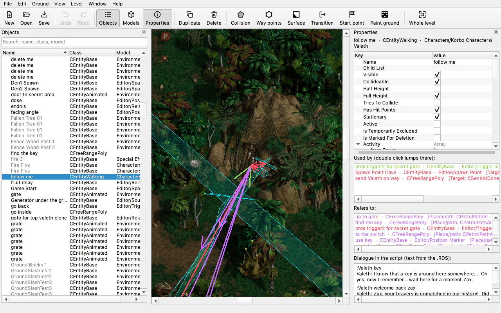
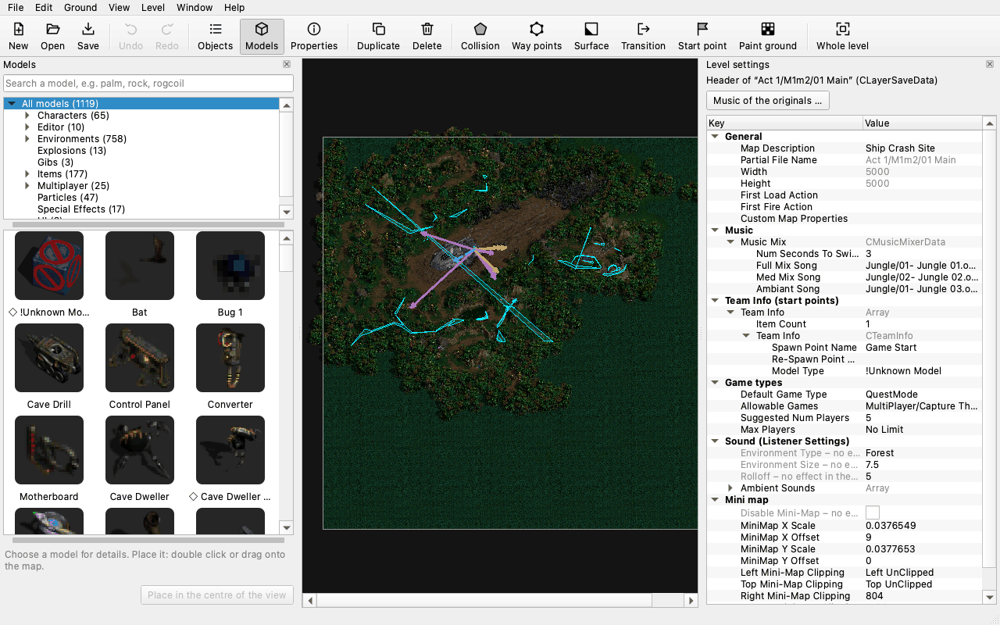
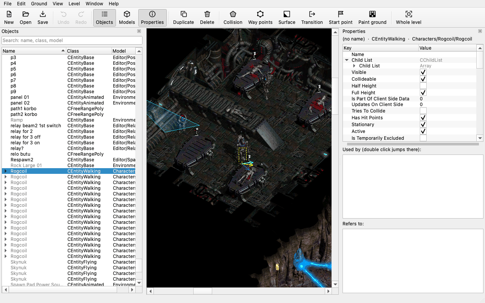

# zax-editor

The level editor for "Zax: The Alien Hunter" (Reflexive Entertainment / JoWooD, 2001), PySide6: objects, polygons, ground, surfaces, mini map, transitions, dialogue scripts, own graphics, a model viewer, Test in game; English with a German translation.

*A level open in the editor: the object list, the map with the links of the selected character, its properties, who uses it and its dialogue.*

| | |
|---|---|
|  |  |
| The model browser and the level settings (music, start points, mini map) | A cave level close up, a Rogcoil selected |

It is built on **zaxtools** from [zax-formats](../zax-formats) (every file format of the game read and written byte for byte), which it expects next to this repository (or `ZAX_FORMATS`). The decompilation of Zax.exe is zax-decomp (its docs explain the engine behind the editor's checks and help texts); Test in game runs the VM tool of the test harness next to it (`ZAX_TESTTOOLS`), which is not published. Until 2026-11-07 the editor and the format library were one repository, zax-toolbox.

## Setup

1. Python 3.10 or newer: `python3 -m venv .venv && .venv/bin/pip install -r requirements.txt`
2. zax-formats next to this repository (or `ZAX_FORMATS`).
3. Point `ZAX_DATA` to the game data (the `Data.dat` of an installed game, or an unpacked `Data` folder), or choose it in the editor.
4. Start the editor: `python -m zaxeditor` (on macOS also by double-clicking `Zax-Editor.command`); the model viewer: `python -m zaxeditor.viewer`.
5. Check the UI texts: `python tools/selftest_ui.py` – expected: 0 failures; the format library's self-test is zax-formats' `tools/selftest.py`.
6. `git config core.hooksPath tools/git-hooks` (the pre-push hook: no game data, no private names or paths).

The game data is not included and must never go into the repository: every player brings the original assets from their own copy. The editor saves into its own output folder, never into the game data.

## Packages

Ready-to-run builds that need no Python installation; at the first start they ask for the game data (`Data.dat`) of your own copy, nothing of the game is in them. Right after that they ask where your own levels, graphics and `Rules.txt` go, suggesting `Zax-Editor-Output` in your documents folder; any other folder works, except one inside the editor itself (the app or the unzipped folder), inside the game data or the folder of `Data.dat`, or one that cannot be written to. "Later" opens the editor without one, and it asks again before it saves anything. File → Settings changes the folder later. (Run from the source checkout, the editor keeps using the workspace's `editor-output/`.)

- **macOS (Apple silicon):** `tools/package_macos.sh OUT_DIR` builds `Zax Editor.app` with PyInstaller (a build venv in `OUT_DIR` with pinned versions; QtCore/QtGui/QtWidgets plus QtMultimedia for the model viewer's sound, zaxtools from zax-formats, the translations) and zips it as `Zax-Editor-<version>-macos-arm64.zip`. The app is signed ad hoc only (not notarised): after a download macOS refuses the first start; allow it in System Settings → Privacy & Security → Open Anyway (older macOS: right-click → Open), or remove the quarantine with `xattr -dr com.apple.quarantine "Zax Editor.app"`.
- **Windows (x64):** `tools/package_windows.sh OUT_DIR` builds a portable folder on the Mac, without Windows: the official embeddable Python of python.org and the win_amd64 wheels of `tools/package/windows-requirements.txt` (both hash-checked, only unpacked), filtered to what the editor uses, started by `Zax Editor.exe`, a small native starter (`tools/package/starter.c`, zig). Unzip the whole `Zax-Editor-<version>-windows-x64.zip` and start `Zax Editor.exe`; the exe is unsigned, so SmartScreen may ask once (More info → Run anyway).

The model viewer's sounds are decoded by the editor itself (WAV with Python's `wave`, Ogg Vorbis with python-soundfile/libsndfile) and played as raw PCM through Qt's `QAudioSink`, so the packages contain no FFmpeg and no Qt media backend plugin. Each package carries `THIRD_PARTY_NOTICES.txt`, the licence texts of the bundled parts (`licenses/`: Python PSF, PySide6/Qt LGPL-3.0 as separate replaceable libraries, numpy BSD, Pillow HPND, capstone BSD, pefile MIT, python-soundfile BSD with libsndfile LGPL-2.1 as a separate replaceable library, cffi MIT) and `VERSIONS.txt`. `tools/package/zax_pkg_smoke.py` is the packages' smoke test (own settings, a level opened, a screenshot of the window; `--sound`: one WAV and one OGG played through `QAudioSink`, with the loaded media plugins and FFmpeg libraries in the report).

## Licence

MIT (`LICENSE`). The editor uses PySide6 (Qt for Python, LGPL-3.0) and python-soundfile (BSD, with libsndfile, LGPL-2.1), which are installed separately and not part of this repository. This licence covers only the project's own code and documentation. It grants no right to "Zax: The Alien Hunter" itself: the game, its executable, data, texts, names and artwork belong to their rights holders, are not included, and every player brings them from their own copy.
